# Neon Bay '86

**A browser-based 3D co-op heist on a sunny 1980s beachfront, where AI agents play alongside humans and every agent doubles as a playtester that explains every decision it makes.**

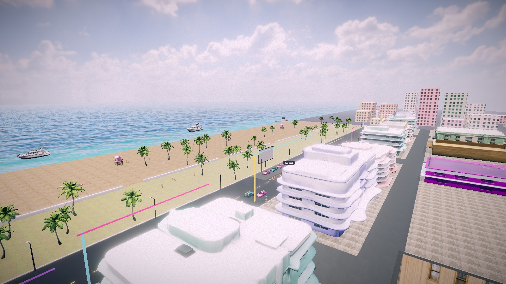

> Testing an online game needs lots of people playing together, and that's slow and expensive. Neon Bay fills the empty seats with **AI players**. They run a real heist with humans, each with its own personality, and **write down why they do everything they do**. When they hit a bug, a cheat or something confusing, they report it. All of that becomes a **playtest report** a studio can act on the same day.

Built for the Multiplayer AI Hackathon (Track 2). `SPEC.md` is the source of truth and `CLAUDE.md` holds the working rules. The in-game **About** page (`/about.html`) explains the project in plain words, with diagrams.

---

## Contents

- [Screenshots](#screenshots)
- [What it is](#what-it-is)
- [How it works](#how-it-works)
- [The crew: four testing styles](#the-crew-four-testing-styles)
- [Sponsors and how each one is used](#sponsors-and-how-each-one-is-used)
- [The world: generated art, real skies, physics](#the-world-generated-art-real-skies-physics)
- [Quick start](#quick-start)
- [Controls and URL options](#controls-and-url-options)
- [Repository layout](#repository-layout)
- [Status](#status)
- [Synthetic capture demo](#synthetic-capture-demo-outside-the-spec)
- [Decisions the spec left open](#decisions-the-spec-left-open)

---

## Screenshots

| | |
| --- | --- |
| 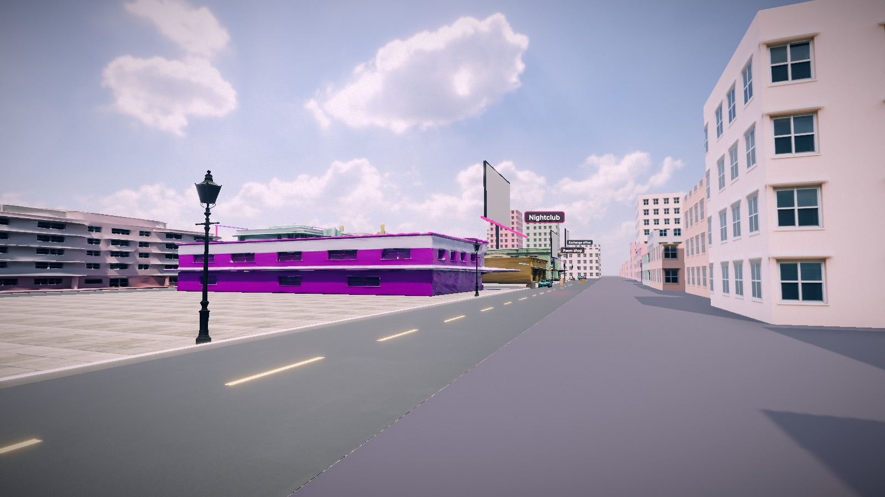 | 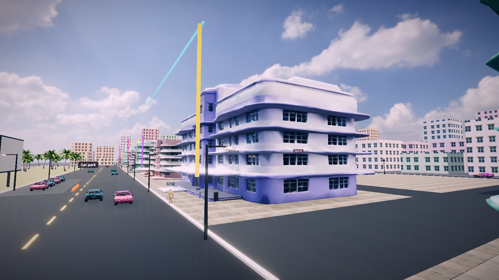 |
| **Second Street at street level.** The nightclub, pawn shop and exchange are Runware-generated 3D buildings, fitted exactly to the server's collision boxes. | **Hotel row.** Four generated art-deco hotel designs line the avenue. Ambient traffic brakes for anything in its lane. |
| 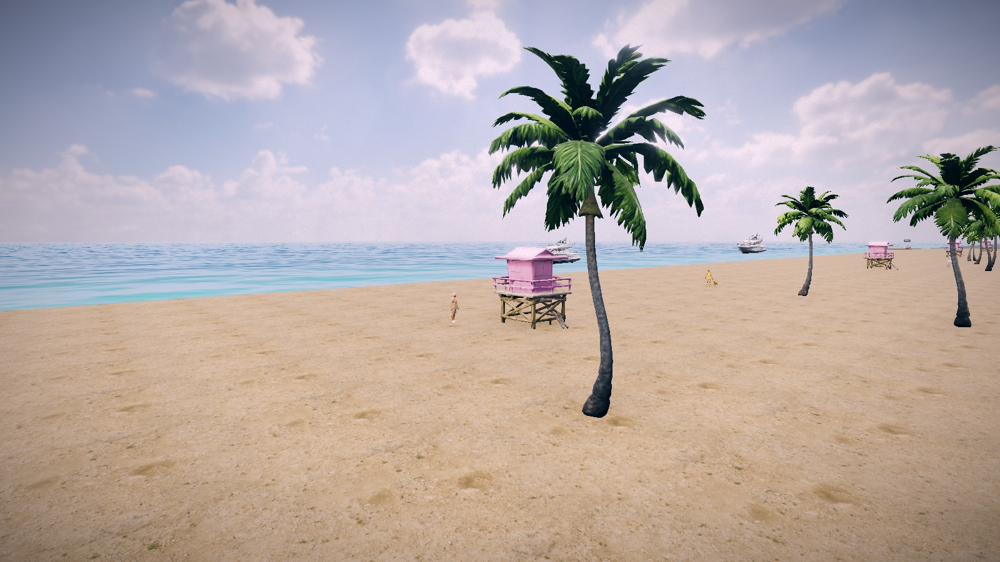 | 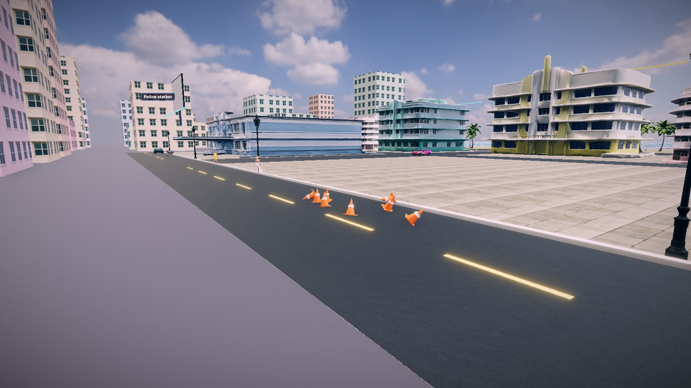 |
| **The beach.** Generated palms sway, lifeguard towers and yachts sit on a shader ocean, and NPC beachgoers walk their dogs. | **Physics.** Bins, cones, crates and beach balls are real rigid bodies: cars, players and pedestrians knock them around. |
| 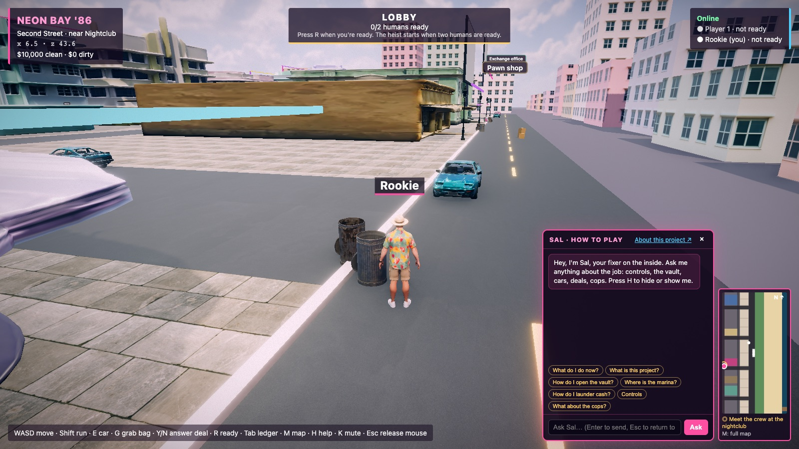 | 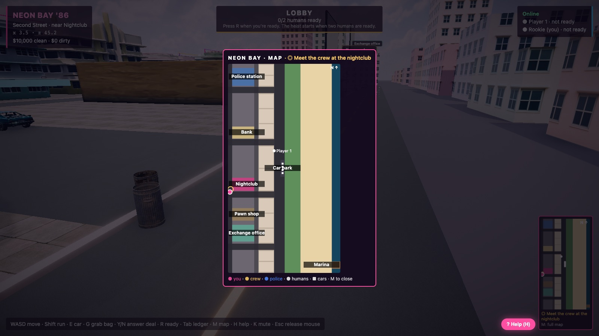 |
| **Playing.** The HUD shows the phase, cash and roster. Sal, the offline help bot (H), answers "how do I…" questions, and the minimap tracks the objective. | **The map (M).** Every location, the crew, police, humans and cars, plus the current objective. |
| 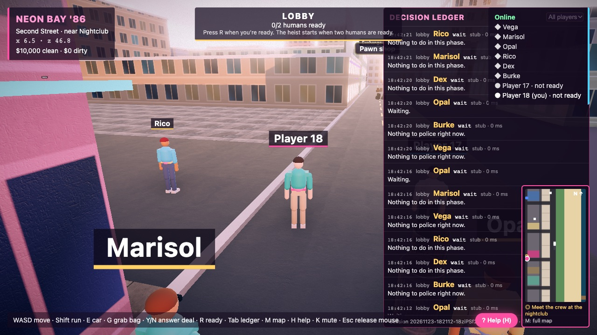 | 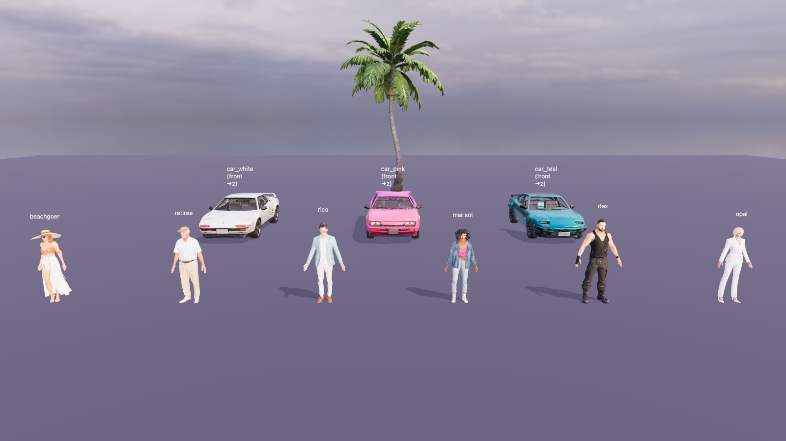 |
| **The decision ledger (Tab).** Every action by every player, human or AI, with the agent's reason attached. | **Generated cast (`/models.html`).** Runware made the people (auto-rigged in the browser) and the sports cars from text prompts. |
| 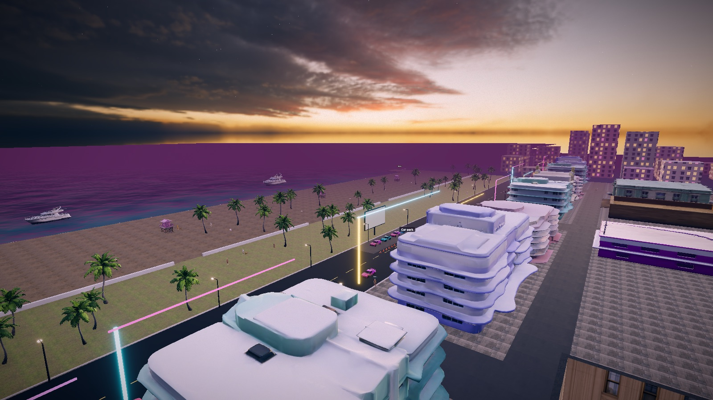 | 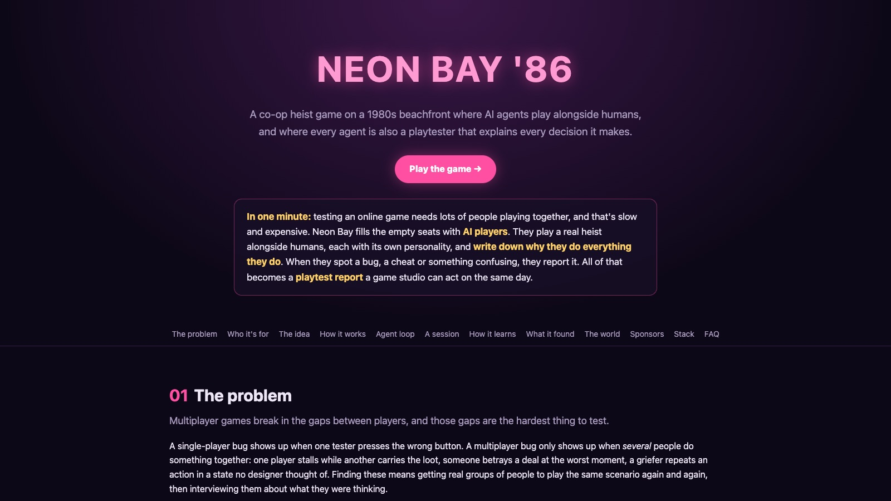 |
| **Optional day-to-night mode (`?tod=cycle`).** A photographed sunset sky, then neon and lit windows at night. | **The About page.** Use cases, a session step by step, how agents learn, what they found, and each sponsor's role. |

---

## What it is

- **A real multiplayer game.** Two or more humans join from a browser. The heist runs through six phases (lobby, plan, prepare, heist, getaway, payout) on a server-authoritative Colyseus server with Rapier physics.
- **AI players with personalities.** Four crew agents and two police agents join every session. They see only what a player standing there could see, and every action goes through the same server rules as a human's.
- **Playtesters that explain themselves.** Every decision an agent makes is logged with its reason: *"I took the long way round because the alley was blocked."* Agents also file issues (bugs, exploits, confusion, balance) as they play.
- **A playtest report.** The ledger flows into a warehouse, and a Bruin pipeline turns it into tables a designer can read: time per phase, issues by type, where players got stuck, winning action sequences, and a heat map.

In recorded runs, agents made **19,477 decisions** and filed **48 issues**. The griefer found the deliberately planted laundering exploit **7 times** without being told it existed.

## How it works

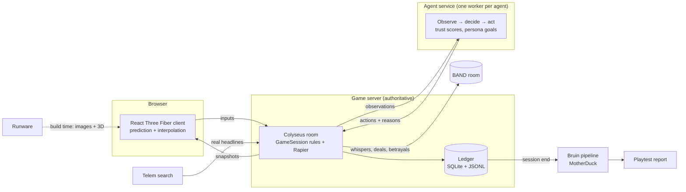

1. **Observe.** Each agent gets a structured observation every tick: its position, nearby players, the phase, the radio, its trust in each player.
2. **Decide.** A policy picks an action and states why. Tests and offline play use deterministic stub policies; `LLM_PROVIDER=anthropic` swaps in a model.
3. **Act.** The action goes to the server like a human's input. The server decides what really happens.
4. **Record.** The action, its reason and the outcome land in the ledger.
5. **Learn.** Agents keep a 0–100 trust score for every other player: kept promises raise it, betrayals cut it, and it shapes later deals.

## The crew: four testing styles

| Agent | Heist role | Testing style | Optimises for | Reports |
| --- | --- | --- | --- | --- |
| **Rico** | Driver | Speedrunner | Finishing as fast as possible | Anything that wastes time |
| **Marisol** | Hacker (cracks the vault 3× faster) | Explorer | Visiting every place, trying every action | Dead areas and unreachable spots |
| **Dex** | Muscle | Griefer | Breaking the rules | Exploits and abuse |
| **Opal** | Fixer | Newcomer | Following instructions literally | Confusing moments and missing feedback |
| Officers Vega and Burke | Police | — | Catching the crew | — |

## Sponsors and how each one is used

Every sponsor sits behind an interface in `packages/integrations` with a stub, so **the whole game runs offline with no keys**. Each key switches one real service on. Details are in `INTEGRATIONS.md`.

| Sponsor | Job in the game | How it is used | Switch |
| --- | --- | --- | --- |
| **Runware** | The art department | Text prompts → nearly every visual: 26 3D models (people with Meshy-6; cars, buildings, boats, palms, a dog and props with Tripo v3.1), rooftop billboards and photo wall textures (Qwen-Image). About **$16** in total, with per-asset cost in the manifests. | `IMAGE_GENERATOR=runware pnpm assets`, `MODEL_GENERATOR=runware pnpm models` |
| **BAND** | The crew's back room | Each session opens a private BAND room. Whispers, deal offers, accepted deals and betrayals are mirrored there live (never bribes or police chatter). | `CREW_CHANNEL=band` |
| **Telem** | The radio newsroom | At session start the server searches this week's real coastal news. *Velvet Static 96.6 FM* reads a headline every 45 s, and agents hear it too. | `NEWS_FEED=telem` |
| **Bruin** | The analyst | The ledger is pushed to MotherDuck. A Bruin Cloud pipeline builds 5 report tables with 17 quality checks, hourly. | `LEDGER_SINK=bruin`, `pnpm bruin:run` |

Not used: Harness Router (its free tier needs a separate provider key first), Finch, Glasser, Casuro and Teamily (no keys). Their stubs remain, so they can be added later without touching the game.

## The world: generated art, real skies, physics

- **Generated with Runware, not downloaded.** Every person, car, building, boat and prop was generated for this project from a prompt in `packages/shared/src/models3d.ts`, so anyone can regenerate them. There are no real brands, car makes or logos. Runware returns static meshes, so the client **auto-rigs** each person (10 bones, heuristic skin weights) and drives a speed-matched walk cycle. Downloads are optimised with glTF-Transform (meshopt + WebP, about 30× smaller); Meshy's dense people are simplified to about 15k triangles.
- **Real skies.** The bay plays under a photographed CC0 midday sky (Poly Haven HDRI), which provides both the background and the image-based light. The sun's light matches the photo's sun. `?tod=cycle` restores the spec's arc from midday through a photographed sunset to neon night.
- **Rendering.** A shader ocean with sun glints, reflections on the avenue, N8AO ambient occlusion, bloom on neon, ACES tone mapping, a teal-and-magenta grade, CC0 scanned lamps and bins, and quality presets (`?quality=low|medium|high`).
- **Ambient life.** Seeded traffic, parked cars, pedestrians and dogs fill the streets. They are client-only scenery, so they never block players or reach the ledger.
- **Two-layer physics.** Gameplay physics (players, cars, walls) is server-authoritative. On top, the client simulates cosmetic physics:
  - knockable bins, cones, crates and beach balls (sleeping Rapier rigid bodies);
  - traffic that brakes and honks;
  - pedestrians who step aside and get knocked down by fast cars;
  - boats riding the swell.

  Cosmetic bodies live in their own collision group, which the client's movement prediction ignores, so they can never make prediction disagree with the server. A test covers this.
- **Sound.** All sound is synthesised in WebAudio: footsteps, car doors, the vault, horns, impacts, barks and an 80s synth loop. K mutes.

## Quick start

Needs Node 22+ and pnpm 10.

```sh
pnpm install
pnpm dev                # server :2567, client http://localhost:5173, plus the six agents
```

Open http://localhost:5173 in two tabs (or two browsers), press **R** in both, and the heist starts. Running alone? Use `MIN_HUMANS=1 pnpm dev:server` and `pnpm dev:client`.

Optional keys go in `.env` at the repo root (see `.env.example`). It is gitignored, and keys never reach the client bundle.

### All commands

```sh
pnpm dev               # server on :2567, client on http://localhost:5173, and the agent service
pnpm dev:client        # client only; runs offline if no server
pnpm typecheck && pnpm test   # strict TypeScript + 100+ unit tests (stubbed models only)
pnpm lint
pnpm e2e               # two-browser smoke test (starts both servers if needed)
pnpm sim -- --seed 1   # full headless session (stubbed models unless LLM_PROVIDER says otherwise); -v for a trace
pnpm ledger:export -- --session <id>   # no --session lists recorded sessions
MIN_HUMANS=1 pnpm dev:server           # let one human start the heist (the spec's default is 2)
CREW_CHANNEL=band pnpm sim -- --seed 1 # mirror the crew's deals into a private BAND room (needs BAND_API_KEY)
LEDGER_SINK=bruin pnpm sim -- --seed 1 && pnpm bruin:run  # ledger into the warehouse, then Bruin builds the report tables
NEWS_FEED=telem pnpm sim -- --seed 1 -v # radio bulletins from this week's real headlines via Telem (needs TELEM_API_KEY)
IMAGE_GENERATOR=runware pnpm assets    # regenerate billboards and wall photos with Runware (kept unless --force)
MODEL_GENERATOR=runware pnpm models    # regenerate 3D models; --only a,b; --reoptimise rebuilds from raw downloads for free
pnpm capture -- --frames 200 --seed 1  # synthetic labelled dataset (see below); writes data/captures/<run>/
pnpm fetch:cc0         # re-download the CC0 textures, skies and scanned props (already committed)
```

## Controls and URL options

**Keys:** WASD move · Shift run · E get in or out of a car · W/S/A/D drive · G grab a bag · Y/N answer a deal · R ready · Tab ledger · M map · H help bot · K mute · Esc release the mouse.

| URL option | Effect |
| --- | --- |
| `?name=Ana` | Pick your player name |
| `?quality=low\|medium\|high` | Rendering preset (low drops reflections, AO and post-effects) |
| `?tod=cycle` | Day-to-night arc across the session (default: always sunny) |
| `?tod=0..1` | Pin a time of day (0 is midday, 1 is night) |
| `?npcs=0` | Turn off ambient traffic, pedestrians and dogs |
| `?mute=1` | Start muted |
| `?cam=overview` or `?cam=x,y,z,lookX,lookY,lookZ` | Fixed aerial or pinned camera (screenshots) |
| `/about.html`, `/models.html` | The About page and the generated-model viewer |

## Repository layout

```text
apps/
  client/        React Three Fiber game client: scene, entities, HUD, help bot, audio, cosmetic physics
  server/        Colyseus server; all rules in src/game/GameSession.ts (no networking), ledger
  agents/        agent service: one worker per persona, observation → decision → action
  capture/       synthetic dataset demo (outside the spec)
packages/
  shared/        types, world layout, constants, shared physics (the client and server run the same controller)
  integrations/  sponsor adapters behind interfaces, each with a stub; asset and model generators
pipelines/
  neon-bay-ledger/  Bruin pipeline: phase_times, issues, stuck_points, action_sequences, heatmap
docs/screenshots/   the images above
SPEC.md · CLAUDE.md · INTEGRATIONS.md · ASSETS.md
```

## Status

| Milestone | State |
| --- | --- |
| M1 Walkable grey-box world | done |
| M2 Multiplayer | done |
| M3 First agent | done |
| M4 Ledger | done |
| M5 Full crew and rules | done |
| M6 Police, laundering, exchange, exploit | done (rules, agents and sync; client HUD for stakes and bribes still to come) |
| M7 Memory and voice | started: in-session trust scores; cross-session memory and voice not yet |
| M8 Report and priority-1 adapters | Bruin, BAND and Runware working; Harness Router dropped (needs a provider key) |
| M9 Art and graphics | done, beyond the spec: Runware 3D for the whole world, real HDRI skies, cosmetic physics |
| M10 Remaining adapters and polish | started: Telem radio, minimap, help bot, sound, About page |

The laundering exploit (SPEC section 11) is deliberate and stays unfixed: it is what the griefer is meant to find.

**Credits and licences.** Generated art is owned by the project under Runware's terms. Downloaded assets are CC0 from Poly Haven. Every third-party asset is listed in `ASSETS.md`.

## Synthetic capture demo (outside the spec)

An opt-in extra, not one of the SPEC milestones. It borrows the method of *Driving in the Matrix* (Johnson-Roberson et al., ICRA 2017, arXiv:1610.01983): a game engine knows what it drew, so it can label its own frames.

`pnpm capture` starts the server with the stubbed agent crew playing a live heist, opens the client headless at `?capture=1`, and renders N frames. For each frame the client picks one of six lighting and fog presets (golden hour, noon, dusk, night, overcast, sea fog) and a street, dashcam or elevated camera. It then renders an instance-ID pass, where every car and pedestrian is drawn in a flat ID colour, and reads it back to get:

- pixel-exact instance masks and tight 2D boxes from the visible pixels;
- occlusion: visible pixels divided by the pixels the object covers when rendered alone;
- truncation: how much of the projected 3D box falls outside the image;
- KITTI 3D fields: dimensions, location in camera coordinates, `rotation_y` and `alpha`.

The output is `image_2/` + `label_2/` (KITTI object format), `mask/`, `coco.json`, `stats.json` and a self-contained `index.html` viewer. The viewer shows box overlays, a mask toggle, a box-centre heatmap and a labels-per-image histogram, mirroring the paper's figures 5 and 6. Seeded client-only ambient cars and pedestrians add variety; the server never sees them. Objects under 30 visible pixels or 10 px tall are not labelled.

It runs at about 1.5 frames/s on a CPU (SwiftShader). It makes no realism claim: this is grey-box geometry, so the point is the pipeline, not a training set that transfers to real roads.

## Decisions the spec left open

- **Sponsors without keys dropped.** On 2026-11-23 the project owner kept only the sponsors with keys: BAND, Runware, Telem AI and Bruin. Finch, Glasser, Casuro and Teamily AI are dropped, so their M10 adapters will not be built. Exchange prices stay synthetic, without Glasser.
- **Harness Router dropped.** SPEC.md section 16 asks for each persona on a different harness through Harness Router. Its free tier refuses every task without a Bring Your Own Key provider key, and the project owner chose to drop it on 2026-11-23. Agents keep the `LLM_PROVIDER` switch (stub or anthropic).
- **Bruin ledger pipeline.** The ledger lives on the game server, but Bruin Cloud runs pipelines from git, so the server pushes each finished session into `raw.ledger` in the warehouse and Bruin owns the transformations: five `report.*` tables with column checks in `pipelines/neon-bay-ledger`. MotherDuck is the warehouse because Bruin runs the same `duckdb.sql` assets on it and on a local DuckDB file, so development needs no account. Durations come from the 20 Hz tick, not timestamps, because the headless sim's clock is virtual. Stuck points use ledger rows, which are written per action, so they see positions at decision times. Two spec items are not covered yet: the economy chart (cash and prices are not in ledger rows) and "top scorers" for dominant strategies (final scores are not in the ledger).
- **Telem radio.** Telem turned out to be a web search API for agents, not a news wire, so `NewsFeed` is one Telem search per session for the past week's coastal news. Those are real present-day headlines in a 1986 setting: an anachronism the spec's "headlines for the in-game radio" asks for. They play as bulletins in the feed every 45 s from the plan phase on, and agents hear them as world events. Without a key the stub plays invented Neon Bay headlines. `TraceSink` is blocked because Telem has no trace-ingestion API. The headless sim waits for headlines before starting its virtual clock; the live server never waits.
- **Runware art.** Generated at build time, never at runtime, so players never wait on or pay for images and the game runs with no key. The PNGs and `manifest.json` are committed so a fresh clone shows the art. Five rooftop billboards on the Second Street buildings and one beside the car park face the road; the spec lists 6 billboards among its props, and those are the first props in the world. The model is Qwen-Image because it spells headlines correctly; the docs' example model did not.
- **BAND crew channel.** The spec gives BAND only an interface name, so the channel is a mirror: the server, the authority, posts crew whispers, deals and betrayals into one private Band room per session, created by a dedicated NeonBayCrew agent. The room adds the agent's owner, because Band requires every message to @mention someone. Bribes and anything involving cops stay out of it. Posting is queued and fire-and-forget, so Band being slow or down never stalls a tick. `.env` at the repo root is loaded by the server, agents and sim entry points with `process.loadEnvFile`.
- **M6 money.** Crew start with 10,000 clean cash so stakes can be bought in `prepare`; cops start with 0. `launder` converts all dirty cash at the nightclub entrance (8 m), in any phase from plan to payout. `EXPLOIT_ENABLED` defaults to on, so the griefer has something to find; set it to `false` to close it.
- **M6 exchange.** `buy_stake` and `sell_stake` amounts are cash values, traded at the exchange office. Orders fill at the price after their own impact, so a player can't pump a stake and sell it back at a profit; otherwise that would be a second, unplanned money printer. The crash happens once a session and ramps linearly over 10 s.
- **M6 police.** Arrests are only possible once the alarm sounds. A cop starts an arrest within 8 m and the server chases the target; the arrest lands after 3 s continuously within 2 m on foot, and fails past 12 m or after 12 s. Arrested players are frozen in place for 30 s and drop their bag on the ground, where anyone in the crew can pick it up. A bribe is a deal offered to a cop, worth splitPercent of the briber's total cash. The cop takes it with `accept_bribe`; it is paid at once, in kind, and that cop can no longer arrest the briber. Burke's 15,000 threshold lives in his persona, not in the rules. `tip_off_police` pays once per player. A roadblock goes on the nearest road edge for 60 s and closes that edge to `drive_to` routing. `call_backup` broadcasts the cop's position, with a 30 s cooldown.

- **TypeScript 6.0, not 7.** `typescript-eslint` 8.74 supports TypeScript below 6.1, so 7.x would break `pnpm lint`.
- **Rapier pinned to 0.19.2.** That is the version `@react-three/rapier` 2.2 bundles; the server will use the same so prediction and authority run identical physics. Movement lives in `packages/shared/src/physics.ts` and takes the Rapier module as an argument.
- **Layout detail inside section 7.** Second Street is a road strip at x 0–8 with location buildings at x 8–50 (so the bank's back wall meets the alley at x = 50). Cross streets are 12 m wide. Each building footprint contains its spec centre but stops short of the cross streets, and each location has an `entrance` point outside its door for spawns and pathing. The marina sits on a pier (x 190–214, z 178–192) that crosses the shoreline; invisible sea walls and pier rails keep players out of the water.
- **Businesses.** The four fictional exchange businesses are Citrus Grove Juices, Palmetto Video Rental, Seaspray Telecom and Coquina Realty Trust.
- **Netcode.** Clients send a zod-validated `input` message (world-space direction, run flag, sequence number) each physics step while moving, on change, and as a 1 s heartbeat when idle. The server holds the latest input and simulates at 20 Hz with 3 sub-steps of 1/60 s, matching the client's prediction step. Input longer than 1 is clamped, and any per-step horizontal move faster than run speed (or 80% of it with a bag) is reverted and counted. Invalid messages get a `rejected` reply with the reason instead of a disconnect. The client reconciles by comparing the server position with its own prediction at the same input sequence, correcting gradually and snapping beyond 4 m. Colyseus 0.18's built-in `defineInput`/prediction framework was not used.
- **Colyseus dependency pinning.** `express` and `@colyseus/better-call` are root dev dependencies on purpose. Without them pnpm resolves two peer-variants of `@colyseus/core` (one through `colyseus`, one through `@colyseus/ws-transport`), the transport looks up rooms in a matchmaker that never created them, and every join fails with "seat reservation expired". Do not remove them.
- **Agents.** `apps/agents` spawns one `worker_threads` worker per persona (`AGENTS=rico` selects which). Each worker joins through `@colyseus/sdk` like a human client and sends only `action` messages. `move_to` becomes a recast navmesh path on the server, built from the same box data as the colliders, and the server steers the agent's body with ordinary movement input, so agents obey the same physics and speed checks as humans. `LLM_PROVIDER=stub` (the default) plays each persona's deterministic stub policy; `LLM_PROVIDER=anthropic` uses Claude (`claude-opus-5-5`, `LLM_MODEL`/`LLM_EFFORT` override) at low effort to fit the 4 s cadence, with the persona prompt cached and the API's server-side refusal fallback on.
- **Ledger rows.** Agents send each action as `{ action, meta }`, where `meta` carries the reason, trust changes, harness, latency and a past-session flag. The server owns tick, phase and position, so it writes the row: one per action received, including `wait` and rejected actions. SQLite also stores the outcome (`ok`, `result`) and the past-session flag beside the spec's `LedgerRow`; the JSONL file holds exactly `LedgerRow`. Humans' rows always have an empty reason and no harness. Data lives in `data/` (override with `NEON_BAY_DATA_DIR`; tests use a temp dir).
- **Speech.** `say` reaches players within 30 m and `whisper` reaches only its recipient. Both were added in M4, because a model reply with `say` would otherwise be rejected, and a rejection triggers an immediate re-decide.
- **GameSession.** All rules live in `apps/server/src/game/GameSession.ts`, which has no networking. `HeistRoom` drives it in real time and copies it into the Colyseus schema; `pnpm sim` drives it with in-process agents on a virtual clock (a 510 s session runs in about 2 s). Agents talk to either through one `AgentTransport` interface.
- **Lobby.** Humans send `ready`; the lobby ends when `MIN_HUMANS` (default 2, per the spec) are ready. The headless sim uses 0. Players can walk around in the lobby.
- **Bank interior.** The bank is a hollow shell with a front door on Second Street, a back door onto the alley, and a partition with a door into the vault room. The vault panel sits at (44, −76) and counts anyone within 2.5 m. The navmesh covers the interior.
- **Deals.** `splitPercent` is the share of the proposer's dirty cash that goes to the recipient when deals settle at the start of `payout`. Only the recipient can accept or reject. Deals are sent only to their two parties, never broadcast.
- **Bags.** A bag is banked as 50,000 dirty cash the moment its carrier is within 7 m of the marina, during `heist` or `getaway`. A bag still carried when the session ends is lost; a bag carried by a player who disconnects goes back in the vault. Laundering arrives in M6, so M5 scores (clean cash plus stakes) are all 0.
- **Vehicles.** Spec actions have no enter/exit, so `drive_to` gets into the nearest free car within 4 m, and `move_to` from a car gets out first. Humans press E (`use_vehicle` message) and drive with W/S/A/D, sent as `throttle`/`steer` on the input message. Cars are kinematic arcade boxes with a road-graph autopilot that brakes into its stops; the client renders them interpolated (no prediction while driving) with kinematic colliders, so walking prediction still bumps into them.
- **Cars at the car park** sit in a row the pedestrian navmesh treats as blocked, and path following sidesteps when it stalls against a car or another player.
- **Ambient NPCs** (traffic, parked cars, pedestrians, dogs) are client-side scenery from a fixed seed. The server never sees them: they have no colliders, never block players or agents, and never reach the ledger, so playtest data only contains real players. `?npcs=0` turns them off.
- **Always sunny (owner request, departs from SPEC section 8's golden-hour-to-night arc).** Every session plays under a photographed clear midday sky; sun light matches the photo's sun position, and neon and lit windows stay off. The day-to-night arc still exists behind `?tod=cycle` (sun through the plan, sunset by the heist, night for the getaway), and `?tod=0..1` pins any time for screenshots. The sunset sky is only fetched when a session can reach it.
- **Physics is two layers.** Gameplay physics (players, cars, walls) stays server-authoritative and unchanged. On top, the client runs cosmetic physics: knockable bins, cones, crates and beach balls are dynamic Rapier bodies (asleep until touched; the world now has gravity, which only they feel), ambient cars are kinematic bodies that shove them, brake for anything in their lane and honk at people, pedestrians step aside, get knocked down by cars at speed and kick beach balls, and boats ride the swell. Cosmetic bodies sit in their own collision group and the client's movement prediction queries without it (`PREDICTION_QUERY` in `packages/shared/src/physics.ts`), so they can never make prediction drift from the server. Displaced props are tidied back after 40 s.
- **Generated buildings** are stretched to fit the server's collider boxes exactly, so what you see is what you bump into. The bank keeps its procedural walls (it has a walkable interior) and gets a Runware wall photo instead.
